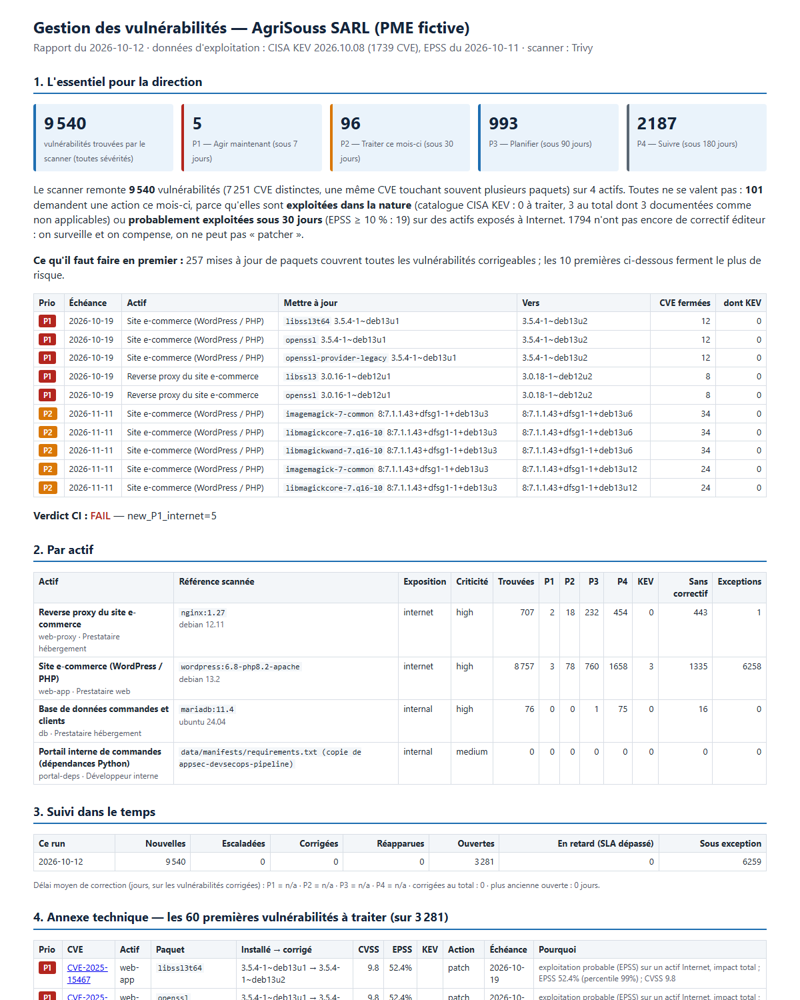

# vuln-management-pme — risk-based vulnerability management for an SME

A **defensive** vulnerability-management pipeline for a fictitious Moroccan SME
(AgriSouss SARL: e-commerce site PHP/MariaDB at an external hosting provider, ~15 people).
It takes real scanner output, adds the two public signals that tell *which* vulnerabilities
are actually dangerous (CISA KEV, FIRST EPSS), decides a priority and a deadline with a
documented SSVC-style tree, remembers every finding between runs (ledger), and produces what
each audience needs: an HTML report the business owner can read, a CSV of upgrade tickets for
the hosting provider, OpenVEX for documented exceptions, and a red/green CI gate.

> **Lab only, real data.** The three assets are the public upstream images of such a stack
> (`nginx:1.27`, `wordpress:6.8-php8.2-apache`, `mariadb:11.4`) scanned with Trivy on
> 2026-10-12, plus the dependency manifest of my [AppSec portal](https://github.com/mohamedelds849-bit/appsec-devsecops-pipeline).
> Nothing is scanned on a third-party host; nothing is exploited. The SME, its exposure
> choices and its exceptions are mine.

**Author:** Mohamed Elansari — cybersecurity engineering student (Universiapolis, Agadir)
**Status (2026-10-12):** pipeline, 102 tests, one real run and a simulated second run are
done locally. **The GitHub Actions `weekly` job has not run yet** (Trivy image by digest +
feed download + gate): unverified until the first run is green.

---

## The result in one table

Real run of 2026-10-12 (`python -m vmp run --today 2026-10-12`, outputs in [`reports/example/`](reports/example/)):

| Step | Count | Comment |
|---|---|---|
| Findings reported by Trivy | **9 540** | 7 251 distinct CVEs on 4 assets; scanner severity: 76 CRITICAL, 1 349 HIGH, 6 020 MEDIUM, 1 950 LOW, 145 unknown |
| In CISA KEV (exploited in the wild) | 3 | all three are Linux **kernel** CVEs reported on `linux-libc-dev` (kernel headers) in the WordPress image |
| Covered by a documented exception | 6 259 | one component-level rule (`linux-libc-dev`, `not_affected`, owner, expiry, justification) + one accepted LOW CVE |
| Actionable | **3 281** | 992 distinct CVEs; 1 794 have no vendor fix yet (`mitigate`) |
| **P1 — act within 7 days** | **5** | one CVE: **CVE-2025-15467** (OpenSSL, CVSS 9.8, EPSS 52 %) on 5 binary packages of the two internet-facing images |
| P2 — within 30 days | 96 | e.g. CVE-2026-23918 (Apache httpd 2.4.65, CVSS 8.8, EPSS 50 %) |
| P3 / P4 | 993 / 2 187 | planned / tracked |
| Upgrades that close everything patchable | 257 | the two first (OpenSSL on nginx and on WordPress) close 8 and 12 CVEs and the only P1 |
| CI gate | **FAIL** `new_P1_internet=5` | expected on a first run: "there is something to do this week" |

Simulated second run 20 days later (nginx patched for OpenSSL and curl, nothing else): 76
findings marked fixed, mean time to remediate 20 days, the WordPress OpenSSL P1 **overdue**
→ gate FAIL `overdue_P1=3`, feeds flagged stale. (That run is a test, not a real rescan.)



## What is in it

```
policy.yml              the whole organisation side: assets (exposure, criticality, owner), SLA per priority,
                        thresholds, exceptions (owner + justification + expiry), gate rules
vmp/ingest.py           Trivy JSON v2 -> Finding (CVSS v3 from NVD first), de-duplicated per (asset, CVE, package)
vmp/feeds.py            CISA KEV + FIRST EPSS: download, parse, enrich, freshness check
vmp/decide.py           SSVC-inspired tree: exploitation x exposure x impact x criticality -> P1..P4 + SLA + reasons
vmp/policy.py           policy validation (an exception without owner/justification/expiry is refused)
vmp/ledger.py           memory between runs: first seen, due, fixed, reopened, escalated, MTTR
vmp/report.py           report.html (FR), summary.json, findings.json, tickets.csv, openvex.json
vmp/gate.py             red / green rules
vmp/__main__.py         python -m vmp run | fetch-feeds | gate
data/scans/*.json       the real Trivy scans of 2026-10-12, slimmed (scripts/slim_scan.py) with the digests scanned
data/ledger.json        the ledger after the real run
tests/                  102 pytest tests; tests/fixtures/feeds = dated KEV/EPSS snapshot (CVEs of the scans only)
.github/workflows/vuln-management.yml   tests, then a weekly real rescan + fresh feeds + gate
docs/METHOD.md          every rule and threshold, with sources
LEARN.md                (FR) how it works, the story of the kernel-headers noise, interview Q&A, CV lines
REVIEW.md               what was really run, bugs found by the tests, honest limits
```

## How a finding is decided

```
Trivy JSON ──> Finding (CVE, package, versions, CVSS, status)
                  │
     KEV ────────>│ exploitation: active (KEV) / likely (EPSS >= 10 %) / unlikely
     EPSS ───────>│
     policy.yml ─>│ exposure (internet / internal / isolated), criticality, impact (CVSS 9 / 7)
                  ▼
        P1 Act 7 d │ P2 Attend 30 d │ P3 Track+ 90 d │ P4 Track 180 d      (docs/METHOD.md §2)
                  │
     exceptions ─>│ not_affected / accepted / false_positive  (owner, justification, expiry) -> OpenVEX
                  ▼
        ledger: first_seen, due, fixed_on, time_to_fix   ->  report.html, tickets.csv, gate
```

Why not CVSS alone: the scanner's 76 CRITICAL + 1 349 HIGH would be 1 425 "urgent" items.
KEV and EPSS bring the question back to *likelihood*; the asset's exposure brings it back to
*this* organisation. Result: 5 items this week, and a written reason for each.

The real lesson of the run: **65 % of the WordPress findings were kernel CVEs on
`linux-libc-dev`**, a headers-only package in a container that runs the host kernel. Three of
them were in KEV and would have been P1. One exception rule, with an owner and an expiry,
documents why they do not apply here and who handles the host kernel. Without that step a
"vulnerability management" report is noise; with it the first real P1 (OpenSSL) appears.

## Run it yourself (Windows, Python 3.11)

```bat
python -m pip install -r requirements-dev.txt
python -m pytest -q                                  :: 102 passed, offline (feed snapshot in tests/fixtures)
python -m vmp fetch-feeds                            :: downloads today's KEV + EPSS into data\feeds (network)
python -m vmp run --today 2026-10-12                 :: decides, updates data\ledger.json, writes reports\
start reports\report.html
```

Rescan the images (Trivy pulls from the registry, no Docker daemon needed):

```bat
curl -LO https://github.com/aquasecurity/trivy/releases/download/v0.75.0/trivy_0.75.0_windows-64bit.zip
:: check the SHA-256 against trivy_0.75.0_checksums.txt, unzip, then:
set TRIVY=path\to\trivy.exe
bash scripts/scan.sh
```

Exit code of `run` = the gate (1 when red), so the same command works in CI.

## What it is not

- Not a scanner: it needs Trivy output (images, file systems, SBOMs). No Nessus/OpenVAS/Grype parser,
  on purpose: only formats really run here are supported.
- Not a view of the real hosting provider: public upstream images at a tag, digests recorded.
- Not a ticketing tool: `tickets.csv` is the hand-off, nothing is sent anywhere.
- Not a substitute for configuration review, code review (see appsec-devsecops-pipeline) or
  external exposure checks (see rssi-audit).

## License

MIT. Trivy (Apache-2.0), CISA KEV (public domain, [terms](https://www.cisa.gov/sites/default/files/licenses/kev/license.txt)),
EPSS (FIRST, free with attribution) are used as data sources only.
